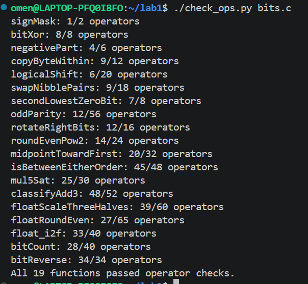
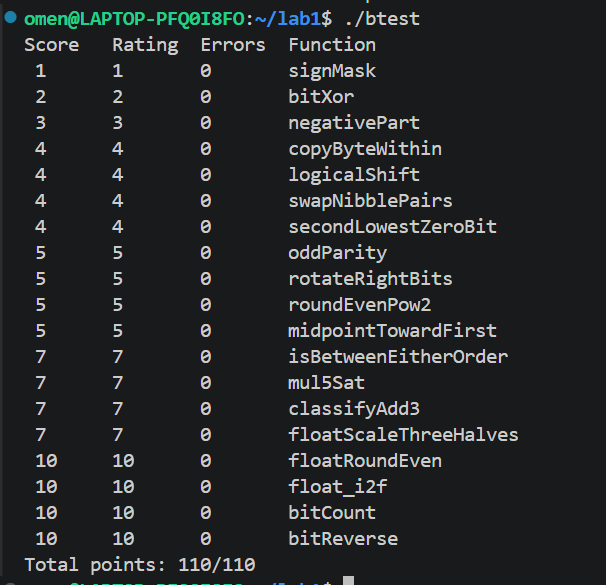

# Lab1 Data Lab 实验报告

姓名：吴尔力克  
学号：25803020025 

## 1. 实验目的

本实验通过限制 C 语言中可以使用的运算符，完成整数和单精度浮点数的位级操作，加深对补码、移位、掩码、整数溢出以及 IEEE 754 单精度浮点数表示的理解。

## 2. 实验环境

- WSL2 Ubuntu
- GCC
- GNU Make
- VS Code
- 测试工具：`dlc`、`btest`

## 3. 实验结果

### 3.1 运算符检查

执行：

```bash
./check_ops.py bits.c
```

检查结果如下：



### 3.2 正确性测试

执行：

```bash
make clean
make all
./btest
```

最终结果为：

```text
Total points: 110/110
```



## 4. 各题实现思路

### P1 signMask

将整数 `1` 左移 31 位，使最高位为 1，其余位为 0，得到 `0x80000000`。

### P2 bitXor

先将异或写成 `(x & ~y) | (~x & y)`，再使用德摩根律，用题目允许的 `~` 和 `&` 替代按位或。

### P3 negativePart

使用 `x >> 31` 得到符号掩码。负数得到全 1，非负数得到全 0。再使用 `~x + 1` 计算 `-x`，通过按位与选择最终结果。

### P4 copyByteWithin

根据 `src` 计算源字节的移动位数，使用 `0xFF` 提取源字节。清空目标字节后，将源字节移动到 `dst` 对应的位置并与原数合并。

### P5 logicalShift

算术右移负数时左侧会补 1，因此构造一个高位为 0 的掩码，清除算术右移产生的补 1，实现逻辑右移。

### P6 swapNibblePairs

使用重复的 `0x0F` 掩码分别提取每个字节的高四位和低四位。将两部分向相反方向移动四位后重新合并。

### P7 secondLowestZeroBit

先对 `x` 取反，使原来的 0 位变成 1。利用 `y & (y - 1)` 删除最低的 1，再使用 `y & -y` 提取剩余部分中最低的 1。

### P8 oddParity

依次将整数与其右移 16、8、4、2、1 位的结果进行异或，将全部位的信息折叠到最低位，最后判断 1 的数量是奇数还是偶数。

### P9 rotateRightBits

使用 `n & 31` 将旋转位数限制在 0 到 31。分别计算逻辑右移部分和移动到左侧的部分，再使用按位或合并。

### P10 roundEvenPow2

将 `x` 分成 `2^n` 的整数商和余数。余数大于中点时进位；余数等于中点时，根据商的奇偶性实现向偶数舍入。

### P11 midpointTowardFirst

使用 `(x & y) + ((x ^ y) >> 1)` 计算不会溢出的中点下界。当精确中点位于两个整数之间时，根据 `x` 和 `y` 的大小决定是否加 1，使结果更接近第一个参数。

### P12 isBetweenEitherOrder

通过符号位和差值完成有符号整数比较。先确定两个端点中的较小值和较大值，再判断 `low <= x` 与 `x <= high` 是否同时成立。

### P13 mul5Sat

通过 `(x << 2) + x` 计算 `5x`，并分别检查左移和加法过程是否发生溢出。如果溢出，则根据原数的符号返回 `INT_MAX` 或 `INT_MIN`。

### P14 classifyAdd3

连续进行两次 32 位加法并记录进位，同时统计三个参数中的负数数量。根据进位数、负数数量和结果符号判断精确数学和是否超出有符号整数范围。

### P15 floatScaleThreeHalves

将浮点数拆分为符号位、阶码和尾数。分别处理规格化数和非规格化数，并采用向最近偶数舍入。NaN 和无穷大保持不变。

### P16 floatRoundEven

根据阶码确定小数部分的位置，清除相应的尾数位。大于中点时进位，正好处于中点时根据整数部分的奇偶性进行舍入；结果为 0 时保留原符号。

### P17 float_i2f

先取得整数的符号和绝对值，再寻找最高有效位并计算阶码。当有效位超过单精度浮点数能够保存的位数时，截去低位并进行向最近偶数舍入。

### P18 bitCount

使用分组统计的方法，依次统计每 2 位、4 位、8 位、16 位和 32 位中的 1 的数量，最终得到整个整数中 1 的总数。

### P19 bitReverse

依次交换相邻的 1 位、2 位、4 位、8 位和 16 位分组。每一步使用掩码提取对应部分并交换位置，最终完成 32 位顺序翻转。

## 5. 实验总结

本实验加深了我对补码、位运算和 IEEE 754 单精度浮点数表示的理解。整数部分的主要难点是利用掩码替代条件判断，并正确处理有符号整数溢出；浮点数部分的主要难点是拆分符号位、阶码和尾数，以及处理向最近偶数舍入。最终代码通过了 `dlc` 规则检查和 `btest` 正确性测试，得分为 110/110。

## 6. 参考资料

1. 课程 Lab1 Data Lab 实验说明。
2. Randal E. Bryant、David R. O’Hallaron：《深入理解计算机系统》。
3. ChatGPT：用于辅助理解题目、检查边界情况和排查代码错误。